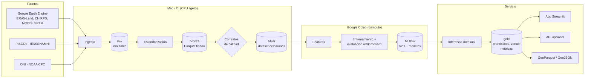

# Sistema de Predicción Climática Huánuco — Diseño de software

> Cómo pasar de un conjunto de scripts de investigación a un software académico con ingeniería de datos de nivel profesional, manteniendo el entrenamiento en Google Colab.

---

## 0. Principios de diseño

| Principio | Qué significa en este proyecto |
|---|---|
| **Reproducible** | Cualquier resultado de la tesis se regenera a partir de un *commit* de Git, una versión de datos (DVC) y un ID de corrida (MLflow). |
| **Idempotente** | Ejecutar dos veces una etapa con la misma entrada produce la misma salida y no duplica datos. |
| **Inmutable en crudo** | Lo descargado de una fuente nunca se edita; toda corrección ocurre en capas posteriores. |
| **Trazable (linaje)** | Cada archivo sabe de qué fuente, versión, fecha de descarga y *checksum* proviene. |
| **Configurable, no editable** | Periodos, rutas, umbrales y modelos viven en YAML, no dentro del código. |
| **Validado** | Cada capa tiene un contrato de datos (esquema + reglas) que se verifica automáticamente. |
| **Cómputo separado del código** | El código se desarrolla y prueba en la Mac con datos pequeños; el entrenamiento completo corre en Colab con el mismo paquete. |

---

## 1. Diagnóstico del estado actual

**Lo que ya está bien hecho (y se conserva):**
- La climatología se calcula solo con entrenamiento, y el ONI va con rezago de 2 y 3 meses para evitar fuga de información.
- La métrica de habilidad frente a la climatología (SS) se reporta además del R².
- Hay ablación por grupos de variables e importancia por permutación.
- Las fuentes están documentadas y las unidades, explícitas.

**Brechas frente a un estándar profesional (detectadas al ejecutar el pipeline):**

| # | Problema | Evidencia en el código actual | Riesgo |
|---|---|---|---|
| 1 | Fuentes "vivas" sin *snapshot* | PISCO se baja del endpoint `.unstable` del IRI: hoy llega a 2026-10, mientras la documentación dice jun-2025. ONI se descarga en cada corrida. | Los resultados de la tesis cambian sin que cambie el código. |
| 2 | El resultado depende del nombre de los archivos | `drop_duplicates(keep="last")` sobre archivos ordenados alfabéticamente (`2015_2029` frente a `2020_2024`). | Renombrar un CSV cambia el dataset. |
| 3 | Parámetros en el código | `--fin 2025-12` por defecto, `OUT = Path("resultados")`, umbrales en constantes. | Corridas no comparables; el pronóstico quedó desfasado a ene–mar 2026. |
| 4 | Las salidas se sobrescriben | `resultados/` es única; el notebook tuvo que renombrar carpetas para las variantes. | Se pierden experimentos anteriores. |
| 5 | CSV como formato intermedio | `celda` y `fecha` como texto; los tipos se reinfieren en cada lectura. | Lento, frágil, sin esquema. |
| 6 | Sin pruebas ni validación de esquema | No hay `tests/` ni contratos. | Errores silenciosos (unidades, columnas renombradas en GEE). |
| 7 | Extracción manual | Se pega el `.js` en el Code Editor y se exporta a Drive a mano. | No se puede automatizar la actualización mensual. |
| 8 | Una sola partición temporal | Entrenamiento ≤ 2021, validación 2022, prueba 2023+. | La métrica depende de un único periodo (por ejemplo, un año El Niño). |
| 9 | La app recalcula sobre datos de trabajo | `app.py` lee el dataset completo y agrega en memoria. | Acoplamiento entre la app y el pipeline de entrenamiento. |
| 10 | Scripts sueltos, sin paquete | `05_modelar.py` crea carpetas al importarse y no se puede reutilizar. | Sin reutilización ni pruebas unitarias. |

---

## 2. Arquitectura general



### Capas de datos (arquitectura *medallion*)

| Capa | Contenido | Formato | Reglas |
|---|---|---|---|
| `raw/` | Archivos tal como llegan de la fuente, más `manifest.json` | CSV, NetCDF, TXT | Inmutable. Nunca se edita; una corrección es una nueva descarga con nueva versión. |
| `bronze/` | Mismo contenido, tipado y con nombres y unidades estándar | Parquet particionado por `fuente/anio` | Una tabla por fuente. Sin uniones ni rellenos. |
| `silver/` | Dataset integrado celda × mes, saneado y validado | Parquet + reporte de calidad | Contrato de datos obligatorio. Los huecos del objetivo no se rellenan. |
| `features/` | Matrices de modelado por horizonte y configuración | Parquet | Se derivan de forma determinista de `silver` + config. |
| `gold/` | Productos finales: pronósticos, normales, zonas, métricas | Parquet, GeoParquet, GeoJSON, PNG | Es lo único que consumen la app, la API y QGIS. |

Las capas de datos no van en Git: se versionan con **DVC** sobre un *remote* en Google Drive, que es justamente lo que Colab puede leer.

---

## 3. Estructura del repositorio

```
huanuco-clima/
├── pyproject.toml              # paquete, dependencias, ruff, mypy, pytest
├── uv.lock                     # versiones exactas (mismo entorno en Mac y Colab)
├── dvc.yaml / dvc.lock         # pipeline de datos reproducible
├── params.yaml                 # parámetros que DVC rastrea (periodos, horizontes)
├── configs/
│   ├── fuentes.yaml            # URLs, colecciones GEE, versiones de producto
│   ├── calidad.yaml            # rangos físicos, umbrales
│   ├── experimentos/
│   │   ├── pisco_base.yaml
│   │   ├── chirps.yaml
│   │   └── t2m.yaml
│   └── app.yaml
├── src/huanuco/
│   ├── cli.py                  # `huanuco ingestar | sanear | features | entrenar | pronosticar | mapas`
│   ├── config.py               # carga YAML → modelos Pydantic validados
│   ├── io/                     # lectura/escritura Parquet, manifest, rutas por capa
│   ├── ingesta/
│   │   ├── base.py             # interfaz Extractor
│   │   ├── gee.py              # Earth Engine Python API (cuenta de servicio)
│   │   ├── pisco.py
│   │   └── oni.py
│   ├── calidad/
│   │   ├── esquemas.py         # contratos pandera por capa
│   │   └── reglas.py           # completitud, rangos, coherencia entre fuentes
│   ├── procesamiento/
│   │   ├── estandarizar.py     # raw → bronze
│   │   ├── integrar.py         # bronze → silver (unión, deduplicado por versión, relleno)
│   │   └── grilla.py           # definición única de la grilla 0.1° (centros .x5)
│   ├── features/
│   │   ├── climatologia.py     # transformador fit/transform (sin fuga)
│   │   ├── rezagos.py
│   │   └── registro.py         # catálogo de predictores y su grupo
│   ├── modelos/
│   │   ├── base.py             # interfaz común (fit, predict, guardar)
│   │   ├── lineas_base.py      # climatología, persistencia
│   │   ├── arboles.py          # RF, XGBoost
│   │   └── red.py              # MLP (y LSTM a futuro)
│   ├── evaluacion/
│   │   ├── particion.py        # walk-forward por año
│   │   ├── metricas.py         # RMSE, MAE, R², KGE, SS
│   │   └── significancia.py    # prueba Diebold-Mariano
│   ├── inferencia/pronostico.py
│   ├── espacial/
│   │   ├── mapas.py
│   │   └── zonas.py            # K-means + silhouette
│   └── app/streamlit_app.py    # solo lee gold/
├── notebooks/
│   ├── colab_entrenamiento.ipynb   # lanzador delgado (ver sección 9)
│   └── exploracion/                # EDA; nunca contiene lógica del pipeline
├── gee/huanuco_extraccion.js       # se conserva como respaldo manual
├── tests/
│   ├── fixtures/                   # 10 celdas × 36 meses sintéticos
│   ├── unit/
│   ├── datos/                      # pruebas de contratos
│   └── integracion/                # pipeline completo con fixtures (< 1 min)
├── docs/
│   ├── adr/                        # Architecture Decision Records
│   ├── data_card.md
│   └── model_card.md
├── data/                           # gestionado por DVC (no en Git)
│   ├── raw/  bronze/  silver/  features/  gold/
└── .github/workflows/ci.yml
```

---

## 4. Configuración

Todo lo que hoy está fijo en el código pasa a YAML validado con Pydantic. Si la configuración es inválida, el programa falla al inicio y no a mitad de una corrida.

```yaml
# configs/experimentos/pisco_base.yaml
nombre: pisco_base
datos:
  periodo: {inicio: "2015-01", fin: "2026-09"}
  objetivo: pp_pisco
  excluir_celdas_inconsistentes: false
features:
  rezagos_objetivo: [0, 1, 2, 3, 11]
  medias_moviles: [3, 6]
  rezagos_predictores: [0, 1]
  oni_rezagos: [2, 3]
  grupos: [objetivo, satelital, enso, geo, estacion]
evaluacion:
  esquema: walk_forward
  anios_prueba: [2021, 2022, 2023, 2024, 2025]
  meses_validacion: 12
  horizontes: [1, 2, 3]
modelos:
  random_forest: {n_estimators: 300, min_samples_leaf: 5, max_features: 0.5}
  xgboost: {n_estimators: 800, learning_rate: 0.03, max_depth: 6, early_stopping_rounds: 50}
  mlp: {hidden_layer_sizes: [64, 32], alpha: 1.0e-3}
semilla: 42
```

```python
# src/huanuco/config.py (extracto)
class Periodo(BaseModel):
    inicio: YearMonth
    fin: YearMonth

    @model_validator(mode="after")
    def orden(self):
        if self.inicio >= self.fin:
            raise ValueError("inicio debe ser anterior a fin")
        return self
```

---

## 5. Ingesta

### 5.1 Interfaz común
```python
class Extractor(Protocol):
    fuente: str
    def particiones_pendientes(self, periodo: Periodo) -> list[Particion]: ...
    def extraer(self, particion: Particion) -> Path: ...   # escribe en raw/ y devuelve la ruta
```

### 5.2 Reglas
- **Idempotencia por partición** (`fuente/anio=AAAA/mes=MM`): si la partición existe y su *checksum* coincide con el manifest, se omite. `--force` vuelve a descargarla como **nueva versión**, sin sobrescribir.
- **Manifest por archivo** en `raw/<fuente>/manifest.json`:
  ```json
  {"fuente": "pisco", "producto": "PISCOp v2.1 monthly (unstable)",
   "url": "https://iridl.ldeo.columbia.edu/...", "descargado": "2026-11-07T14:17:00-05:00",
   "sha256": "…", "periodo": ["1981-01", "2026-10"], "unidades": "mm/month", "version": 3}
  ```
- **Snapshots congelados:** la tesis cita una versión concreta (`pisco@v3`, `oni@v2`). Una actualización del IRI o de la NOAA crea una nueva versión y no modifica la anterior.
- **GEE automatizado:** se usa la API de Python con una cuenta de servicio, sin el Code Editor. Se exporta mes a mes o año a año con `getInfo` (el volumen es pequeño) o con `Export.table.toDrive`, con reintentos y espera exponencial.
- **Reintentos y tiempos límite** en toda descarga, con un error claro que indique la acción manual si falla.

### 5.3 Actualización mensual (incremental)
`huanuco ingestar --hasta 2026-10` descarga solo las particiones nuevas. Después se reconstruyen las capas siguientes; DVC solo vuelve a ejecutar las etapas cuyas entradas cambiaron.

---

## 6. Contratos de datos y calidad

Los esquemas se escriben con **pandera** y hay uno por capa:

```python
SilverSchema = pa.DataFrameSchema(
    {
        "celda":     pa.Column(str, pa.Check.str_matches(r"^-\d+\.\d5_-\d+\.\d5$")),
        "fecha":     pa.Column("datetime64[ns]"),
        "t2m":       pa.Column(float, pa.Check.in_range(-15, 35), nullable=False),
        "pp_chirps": pa.Column(float, pa.Check.in_range(0, 1500), nullable=True),
        "pp_pisco":  pa.Column(float, pa.Check.in_range(0, 2000), nullable=True),
        # …
    },
    unique=["celda", "fecha"],
    checks=[pa.Check(lambda df: df.groupby("celda").size().nunique() == 1,
                     error="todas las celdas deben tener el mismo número de meses")],
)
```

| Tipo de control | Ejemplo | Acción |
|---|---|---|
| Esquema y tipos | Columnas, tipos, formato de `celda` | **Falla** la etapa |
| Unicidad | `(celda, fecha)` única | **Falla** |
| Completitud | 378 celdas × N meses; meses faltantes | **Falla** si falta un mes completo; aviso si hay huecos sueltos |
| Rango físico | `hr ∈ [5, 100]` | Se convierte en NaN y se reporta |
| Continuidad temporal | Saltos de más de 3 desviaciones respecto a la climatología de la celda | Aviso |
| Coherencia entre fuentes | Razón ERA5/CHIRPS, correlación PISCO–CHIRPS > 0.7 | Aviso y marca en la celda |
| Frescura | Último mes disponible por fuente | Se reporta en la app |

Cada corrida genera `silver/reporte_calidad.json` y su versión HTML. Ese reporte es un anexo directo de la tesis (OE1).

---

## 7. Ingeniería de variables sin fuga

La climatología se implementa como un transformador al estilo scikit-learn, de modo que **es imposible** ajustarla con datos de prueba:

```python
class Climatologia:
    def fit(self, df: pd.DataFrame, columnas: list[str]) -> "Climatologia":
        self.tabla_ = df.groupby(["celda", "mes"])[columnas].mean()
        return self

    def transform(self, df: pd.DataFrame) -> pd.DataFrame:
        check_is_fitted(self, "tabla_")
        clim = df.join(self.tabla_, on=["celda", "mes"], rsuffix="_clim")
        for c in self.tabla_.columns:
            df[f"{c}_a"] = df[c] - clim[f"{c}_clim"]
        return df
```

- **Registro de predictores** (`features/registro.py`): nombre, grupo (objetivo, satelital, ENSO, geo, estación), desde cuándo se conoce el dato (latencia de publicación) y fuente. La ablación y la importancia agrupada se generan a partir de este registro, no de listas escritas a mano.
- **Latencia real:** CHIRPS, ERA5 y PISCO se publican con semanas de retraso. El registro declara la latencia y el generador de features solo usa lo que habría estado disponible en la fecha de emisión del pronóstico.
- **Pruebas de fuga** (obligatorias en CI):
  - modificar el objetivo en el periodo de prueba no cambia ninguna feature de entrenamiento;
  - `y(t+h)` nunca aparece entre los predictores de la fila `t`.

---

## 8. Modelado y evaluación

### 8.1 Interfaz única
```python
class Modelo(Protocol):
    nombre: str
    def fit(self, X_tr, y_tr, X_val=None, y_val=None) -> "Modelo": ...
    def predict(self, X) -> np.ndarray: ...
```
Las líneas base (climatología y persistencia) implementan la misma interfaz y se evalúan con el mismo código que los modelos de ML.

### 8.2 Evaluación walk-forward (origen móvil)
En lugar de una sola partición, se entrena con datos hasta el año *k−1*, se valida con los últimos 12 meses de ese periodo y se prueba en el año *k*, para k = 2021 … 2025. Así se obtienen 5 estimaciones independientes por modelo y horizonte, con media e intervalo.

```
2015 ─────────────── 2019 │2020 val│ 2021 test
2015 ──────────────────── 2020 │2021 val│ 2022 test
…
```

En cada pliegue se vuelve a ajustar la climatología y el escalado, de modo que ningún paso de preprocesamiento ve datos futuros.

### 8.3 Rigor académico
- **Significancia:** prueba de Diebold-Mariano entre el mejor modelo y la climatología, para responder si la mejora es real o ruido.
- **Ajuste de hiperparámetros** con Optuna, solo dentro de los pliegues de validación. El espacio de búsqueda se declara en el YAML.
- **Semillas** fijas y registradas; se reporta la variabilidad entre 3 a 5 semillas en el MLP.
- **Evaluación estratificada:** métricas por zona climática, por temporada (lluviosa / seca) y por fase ENSO.
- **Autocorrelación espacial:** variante opcional con validación por bloques espaciales, para medir la generalización a celdas no vistas.

### 8.4 Seguimiento de experimentos (MLflow)
Cada corrida registra:
- **parámetros:** el YAML completo, el *hash* del commit y la versión DVC de `silver`;
- **métricas:** por pliegue, horizonte y modelo;
- **artefactos:** modelos, `predicciones.parquet`, gráficos e importancia.

El modelo elegido se registra como `huanuco-pp@h1` con el alias `produccion`. La tesis cita el `run_id`. Esto reemplaza la carpeta `resultados/`, que hoy se sobrescribe en cada corrida.

---

## 9. Ejecución en Google Colab

El notebook de Colab es solo un **lanzador**: no contiene lógica. Toda la lógica vive en el paquete, que se prueba en la Mac.

```python
# Celda 1 — código en una versión exacta
!git clone --depth 1 --branch v1.2.0 https://github.com/<usuario>/huanuco-clima.git
%cd huanuco-clima
!pip install -q uv && uv pip install --system -e ".[train]"

# Celda 2 — datos versionados desde Google Drive (remote DVC)
from google.colab import drive; drive.mount('/content/drive')
!dvc remote modify gdrive url /content/drive/MyDrive/huanuco-dvc --local
!dvc pull data/silver

# Celda 3 — seguimiento persistente en Drive
%env MLFLOW_TRACKING_URI=file:///content/drive/MyDrive/huanuco-mlruns

# Celda 4 — entrenar
!huanuco entrenar --config configs/experimentos/pisco_base.yaml

# Celda 5 — guardar productos
!huanuco pronosticar --modelo produccion && huanuco mapas
!dvc push data/gold
```

**Reparto de trabajo:**

| Mac | Colab |
|---|---|
| Escribir código, pruebas, CI | Entrenamiento completo, ajuste de hiperparámetros, walk-forward |
| Ingesta y saneamiento (CPU ligero) | Variantes (CHIRPS, t2m) y ablación |
| Pipeline con *fixtures* (< 1 min) | Experimentos con LSTM o GPU a futuro |
| `dvc pull data/gold` y abrir la app | — |

**Paridad de entornos:** fijar en `pyproject.toml` la misma versión menor de Python que usa Colab (consultarla con `!python --version`) y usar `uv.lock` en ambos lados.

---

## 10. Orquestación

Para un proyecto académico, **DVC** es suficiente y deja el linaje explícito. Ejecuta solo las etapas que cambiaron:

```yaml
# dvc.yaml
stages:
  ingestar:
    cmd: huanuco ingestar --hasta ${periodo.fin}
    params: [periodo]
    outs: [data/raw:  {persist: true}]
  estandarizar:
    cmd: huanuco estandarizar
    deps: [data/raw, src/huanuco/procesamiento/estandarizar.py]
    outs: [data/bronze]
  sanear:
    cmd: huanuco sanear
    deps: [data/bronze, configs/calidad.yaml, src/huanuco/procesamiento/integrar.py]
    outs: [data/silver]
    metrics: [data/silver/reporte_calidad.json: {cache: false}]
  features:
    cmd: huanuco features --config configs/experimentos/pisco_base.yaml
    deps: [data/silver, src/huanuco/features]
    outs: [data/features]
  # entrenar y pronosticar se lanzan desde Colab (sección 9)
```

Si más adelante se quiere una actualización mensual automática (fase operativa), se agrega **Prefect** o un *workflow* programado de GitHub Actions que ejecute `ingestar → sanear → pronosticar` el día 15 de cada mes.

---

## 11. Inferencia operativa y verificación

1. El día 15 de cada mes se ingiere el último mes disponible de cada fuente.
2. Se validan los contratos. Si fallan, no se publica el pronóstico y se notifica.
3. Se genera el pronóstico con el modelo `produccion` desde el último mes con todos los predictores disponibles.
4. Se escribe `gold/pronosticos/fecha_emision=2026-11/`, sin sobrescribir los meses anteriores.
5. **Verificación a posteriori:** cuando llega el dato observado, se compara con lo pronosticado y se guarda en `gold/verificacion/`. Esto da la habilidad real del sistema en operación, que es un resultado muy valioso para la tesis.
6. **Monitoreo de *drift*:** distribución de predictores frente a la de entrenamiento (PSI o KS). Una alerta indica que conviene reentrenar.

---

## 12. Capa de servicio

- **App Streamlit:** solo lee `gold/`, con funciones de carga cacheadas, y no calcula climatologías ni agrega el dataset completo. Muestra la fecha de emisión, la versión del modelo y la frescura de cada fuente.
- **API (opcional):** FastAPI con `GET /pronostico?lat=&lon=&alt=` y `GET /zonas`. Respuestas validadas con Pydantic. Permite conectar otros sistemas (municipios, agencias agrarias).
- **SIG:** `gold/celdas.parquet` (GeoParquet) y `celdas.geojson` para QGIS.
- **Despliegue:** Streamlit Community Cloud o un contenedor Docker. Los datos `gold` son pequeños (unos MB) y se pueden empaquetar con la app.

---

## 13. Calidad de software

| Área | Herramienta | Criterio |
|---|---|---|
| Formato y *lint* | `ruff` | Sin errores en CI |
| Tipos | `mypy` (modo estricto en `src/`) | Sin errores |
| Pruebas | `pytest` + `pytest-cov` | ≥ 80 % en `features/`, `evaluacion/`, `calidad/` |
| Pruebas de datos | `pandera` | Contratos de bronze, silver y gold |
| *Hooks* | `pre-commit` | ruff, mypy, que no se suban datos a Git |
| CI | GitHub Actions | Lint, tipos, pruebas y pipeline con *fixtures* en cada PR |
| *Logging* | `logging` estructurado (JSON) | Cada etapa registra filas de entrada y salida, duración y versión |
| Errores | Excepciones propias (`ErrorContrato`, `ErrorFuente`) | Mensajes con la acción sugerida |

**Pruebas mínimas obligatorias:**
- La grilla genera exactamente 378 celdas con centros en .x5.
- La conversión de unidades es correcta (K → °C, m → mm, mm/día → mm/mes).
- El deduplicado es determinista e independiente del orden de los archivos.
- No hay fuga en la climatología ni en el objetivo (sección 7).
- Las métricas coinciden con valores calculados a mano (RMSE, KGE, SS).
- El pipeline completo con *fixtures* produce un `gold/` válido.

---

## 14. Versionado y reproducibilidad

| Qué | Cómo |
|---|---|
| Código | Git + tags semánticos (`v1.0.0` = versión defendida en la tesis) |
| Entorno | `uv.lock`; misma versión de Python que Colab |
| Datos | DVC (`dvc.lock` guarda el hash de cada capa) |
| Experimentos | MLflow `run_id` + commit + versión de datos |
| Resultados de la tesis | Cada tabla y figura indica su `run_id`; `huanuco reproducir <run_id>` la regenera |

---

## 15. Documentación

- `README.md`: instalación, inicio rápido y comandos.
- `docs/data_card.md`: fuentes, licencias, cobertura, sesgos conocidos (ERA5 sobreestima la lluvia hasta 9 veces en 14 celdas; PISCO incluye estaciones de SENAMHI).
- `docs/model_card.md`: uso previsto, métricas por zona y temporada, limitaciones y usos no previstos. Por ejemplo, el sistema no sirve como pronóstico diario del tiempo.
- `docs/adr/`: decisiones con su justificación. Ejemplos:
  - ADR-001: PISCO como objetivo.
  - ADR-002: predecir la anomalía y no el valor bruto.
  - ADR-003: grilla de 0.1°.
  - ADR-004: walk-forward frente a partición única.
- Documentación del código con docstrings y `mkdocs-material`, publicable en GitHub Pages.

---

## 16. Hoja de ruta

| Fase | Entregables | Criterio de aceptación |
|---|---|---|
| **F0. Base** (1 sem) | Repo con `src/`, `pyproject`, `uv.lock`, pre-commit, CI, DVC con remote en Drive | `pytest` y CI en verde con una prueba trivial |
| **F1. Datos** (2 sem) | Extractores PISCO, ONI y GEE (Python API); raw → bronze → silver; contratos pandera; reporte de calidad | `dvc repro sanear` reproduce el silver actual (49 896 filas) y es idempotente |
| **F2. Features** (1 sem) | Transformador de climatología, registro de predictores con latencia, pruebas de fuga | Las features coinciden con las de `05_modelar.py` en el mismo periodo |
| **F3. Modelado** (2 sem) | Interfaz de modelos, walk-forward, Diebold-Mariano, MLflow, notebook lanzador de Colab | Tabla de métricas con intervalo por modelo y horizonte, registrada en MLflow |
| **F4. Productos** (1 sem) | Inferencia, mapas, zonas, gold en GeoParquet | La app lee solo gold; el pronóstico usa el último mes disponible |
| **F5. Servicio** (1 sem) | App refactorizada, API opcional, despliegue | App pública con versión del modelo y frescura visibles |
| **F6. Operación** (opcional) | Actualización mensual programada, verificación y *drift* | Un ciclo mensual completo sin intervención manual |
| **F7. Cierre académico** | Data card, model card, ADRs, tag `v1.0.0`, `reproducir` | Un tercero reproduce las tablas de la tesis desde cero |

### Migración de los scripts actuales

| Script actual | Destino |
|---|---|
| `huanuco_gee_5anios.js` / `01_extraer_gee.py` | `ingesta/gee.py` (+ `.js` en `gee/` como respaldo) |
| `02_descargar_pisco_oni.py`, parte de `04_unir_pisco_oni.py` | `ingesta/pisco.py`, `ingesta/oni.py` |
| `03_verificar_y_unir.py`, `sanear_dataset.py` | `procesamiento/integrar.py` + `calidad/` |
| Unión con PISCO y ONI de `04_unir_pisco_oni.py` | `procesamiento/integrar.py` |
| `05_modelar.py` | `features/`, `modelos/`, `evaluacion/`, `inferencia/` |
| `06_mapas_zonas.py` | `espacial/mapas.py`, `espacial/zonas.py` |
| `app.py` | `app/streamlit_app.py` (solo lectura de gold) |

---

## 17. Definición de terminado

- [ ] `git clone` + `uv sync` + `dvc pull` + `dvc repro` reproducen el silver sin pasos manuales.
- [ ] Cada capa tiene un contrato y un reporte de calidad.
- [ ] Ninguna ruta, periodo ni umbral está escrito en el código.
- [ ] Pruebas de fuga en CI.
- [ ] Evaluación walk-forward con significancia frente a la climatología.
- [ ] Cada figura y tabla de la tesis indica su `run_id` de MLflow.
- [ ] El entrenamiento en Colab usa el mismo paquete y el mismo lockfile que la Mac.
- [ ] La app muestra la versión del modelo, la fecha de emisión y la frescura de los datos.
- [ ] Data card, model card y ADRs completos.
